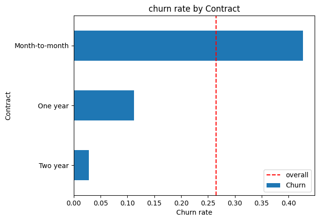
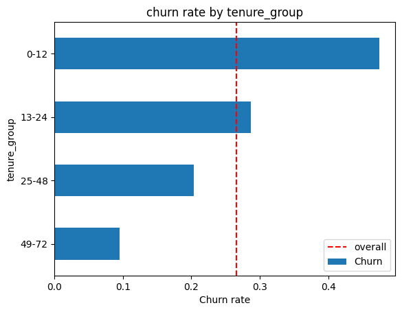
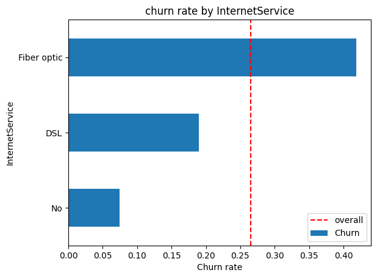
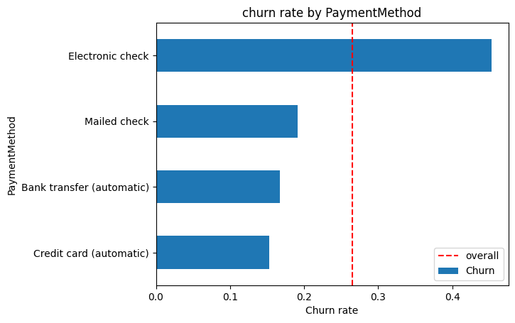
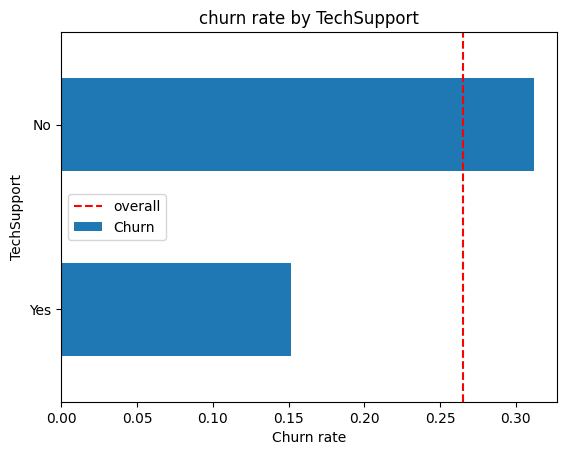
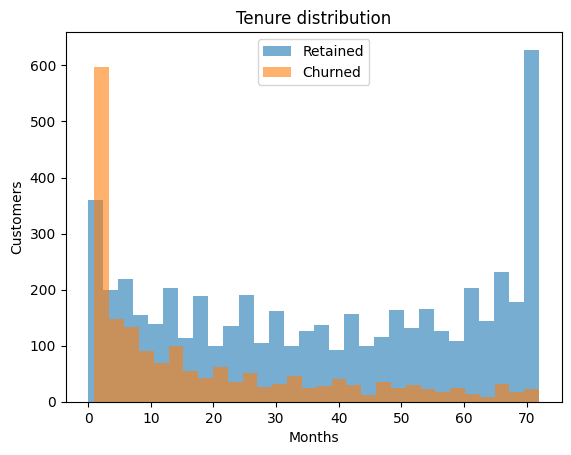
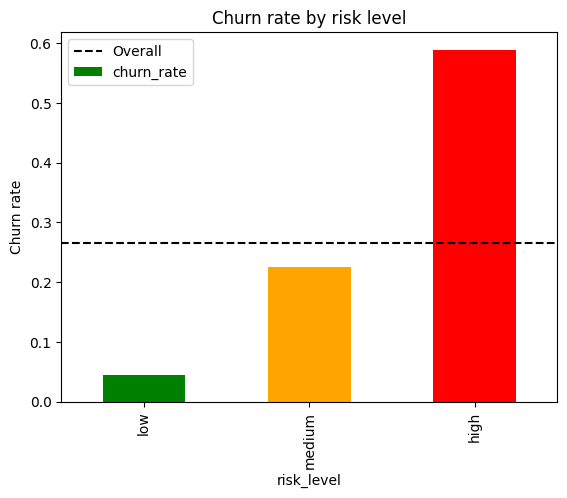
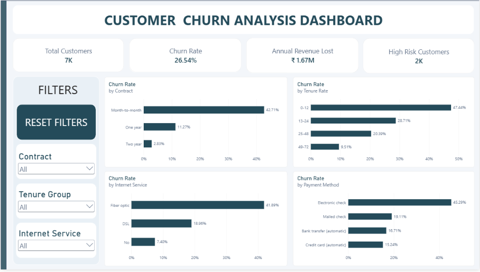
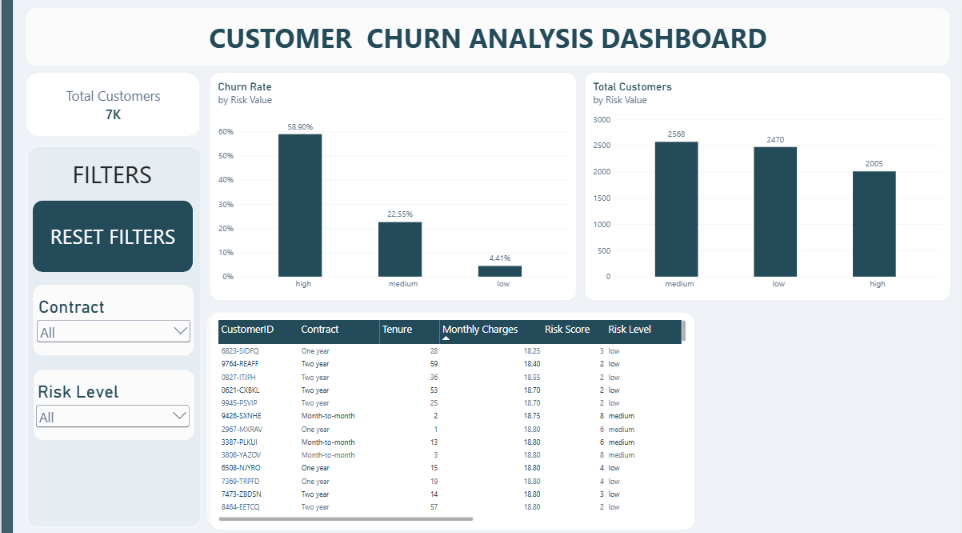

# Telecom Customer Churn Analysis

An end-to-end analysis of 7,043 telecom customers to understand churn, identify at-risk segments, and prioritize retention efforts. The project uses SQL, Python, Excel, and Power BI.

## Table of contents

1. [Business problem](#business-problem)
2. [Project summary](#project-summary)
3. [Dataset](#dataset)
4. [Tools](#tools)
5. [Project structure](#project-structure)
6. [Methodology](#methodology)
7. [Key findings](#key-findings)
8. [Risk scoring model](#risk-scoring-model)
9. [Recommendations](#recommendations)
10. [Dashboard](#dashboard)
11. [How to run](#how-to-run)
12. [Author](#author)

## Business problem

About 26.5% of customers in the dataset have churned. The analysis investigates:

- How churn varies across customer segments.
- Which factors are most strongly associated with churn.
- How to prioritize retention outreach with a simple, explainable score.
- What retention actions the business could test.

## Project summary

| Measure | Result |
|---|---:|
| Customers analyzed | 7,043 |
| Customers churned | 1,869 (26.5%) |
| Monthly charges associated with churned customers | ₹139,131 |
| Annualized charges associated with churned customers | ₹1,669,570 |
| Month-to-month churn rate | 42.7% |
| High-risk segment share | 28.3% of customers; 54.8% of churn |

The revenue figures are estimates based on monthly charges for customers marked as churned, with the monthly amount multiplied by 12. They are not a measure of realized profit or a forecast.

## Dataset

- **Source:** IBM Telco Customer Churn dataset, published on Kaggle by blastchar.
- **Size:** 7,043 rows and 21 source columns.
- **Target:** `Churn` (Yes/No in the source data; converted to 1/0 for analysis).
- **Features:** Customer demographics, account and contract details, charges, and subscribed services.

### Data preparation

- `TotalCharges` was stored as text. The 11 blank values all belong to customers with zero tenure and were set to 0.
- “No internet service” and “No phone service” were normalized to “No” for service add-on analysis.
- No duplicate customer IDs or duplicate rows were found.
- The target is imbalanced: 73.5% of customers stayed and 26.5% churned.
- The raw CSV is retained unchanged; cleaned and scored data are saved separately.

## Tools

| Tool | Use |
|---|---|
| MySQL | Business queries, aggregations, CTE, and window function |
| Python (Pandas, NumPy) | Data cleaning, segmentation, and risk scoring |
| Matplotlib | Exploratory charts |
| Excel | Pivot tables and sensitivity analysis |
| Power BI | Interactive dashboard |
| Git | Version control |

## Project structure

```text
churn-analysis/
├── data/
│   ├── WA_Fn-UseC_-Telco-Customer-Churn.csv
│   ├── telco_clean.csv
│   └── telco_scored.csv
├── dashboard/
│   ├── churn_analysis.xlsx
│   ├── churn_dashboard.pbix
│   ├── page1_overview.png
│   └── page2_risk.png
├── notebook/
│   ├── 01_clean.ipynb
│   ├── 02_analysis.ipynb
│   └── 03_segmentation_risk.ipynb
├── reports/
│   ├── churn_by_*.png
│   ├── churn_by_risk_level.png
│   └── tenure_distribution.png
├── sql/
│   └── analysis.sql
└── Readme.md
```

## Methodology

1. **SQL analysis:** Answered six business questions about overall churn, contract and tenure groups, charges associated with churn, contract revenue ranking, and a high-risk segment.
2. **Data cleaning:** Converted charge and churn fields, normalized service categories, and added tenure groups and service counts.
3. **Exploratory analysis:** Compared churn across contract, internet service, payment method, tech support, and tenure; reviewed tenure distributions and numeric-feature correlations.
4. **Segmentation:** Defined a high-risk segment as month-to-month customers with 12 months of tenure or less.
5. **Risk scoring:** Created an interpretable points-based score from factors associated with churn and compared churn rates across score bands.
6. **Business analysis:** Prepared an Excel sensitivity table for different retention and offer-cost assumptions.
7. **Dashboard:** Built a two-page Power BI report for churn overview and risk analysis.

## Key findings

### Contract type is strongly associated with churn

| Contract | Churn rate |
|---|---:|
| Month-to-month | 42.7% |
| One year | 11.3% |
| Two year | 2.8% |

Month-to-month customers churn about 15 times as often as two-year customers.

### Churn is highest in the first year

| Tenure | Churn rate |
|---|---:|
| 0–12 months | 47.4% |
| 13–24 months | 28.7% |
| 25–48 months | 20.4% |
| 49+ months | 9.5% |

### A focused segment accounts for over half of churn

This rule-based segment is separate from the score-based “High” risk level described below.

| Segment | Customers | Churned | Churn rate |
|---|---:|---:|---:|
| Month-to-month and tenure ≤ 12 months | 1,994 | 1,024 | 51.4% |
| Everyone else | 5,049 | 845 | 16.7% |

The segment is 28.3% of customers and accounts for 54.8% of churn.

### Other factors associated with churn

- Fiber optic customers churn at about 42%, compared with about 19% for DSL and 7% for customers without internet service.
- Electronic check users churn at about 45%, compared with about 15–17% for customers using automatic payment methods.
- Customers without tech support churn at about 31%, compared with about 15% for customers with tech support.

These are observed associations, not proof that a service or payment method causes churn.








## Risk scoring model

The project uses a points-based score so that a retention team can understand the factors contributing to a customer’s score.

| Factor | Points |
|---|---:|
| Month-to-month contract | +3 (one year: +1) |
| Tenure ≤ 12 months | +3 (13–24 months: +1) |
| Fiber optic internet | +2 |
| Electronic check payment | +2 |
| No tech support | +1 |
| No online security | +1 |
| Monthly charges above the median | +1 |

The maximum score is 13. Risk bands are **Low (0–4)**, **Medium (5–8)**, and **High (9+)**.

| Risk level | Customers | Actual churn rate |
|---|---:|---:|
| Low | 2,470 | 4.4% |
| Medium | 2,568 | 22.5% |
| High | 2,005 | 58.9% |

Churn rates rise across the risk bands in this dataset. The score is a prioritization aid, not a causal model or guarantee that an individual customer will churn.




### Illustrative scenario

| Input or estimate | Value | How to update it |
|---|---:|---|
| High-risk customers targeted | 2,005 | Replace with the number your campaign will contact. |
| Observed churners in the High risk band | 1,181 | Recalculate from the latest scored customer data. |
| Revenue at risk (annualized) | ₹1,137,310 | Sum monthly charges for churned customers in the High risk band and multiply by 12. |
| **Assumption: save rate** | **20%** | Replace with a measured campaign save rate when available. |
| **Assumption: offer cost per customer** | **₹20** | Replace with the actual cost of the offer and outreach per targeted customer. |
| Estimated revenue saved | ₹227,462 | Revenue at risk × save rate. |
| Estimated campaign cost | ₹40,100 | Customers targeted × offer cost per customer. |
| **Estimated net benefit** | **₹187,362** | Estimated revenue saved − estimated campaign cost. |

This is an illustrative 12-month revenue scenario, not a measured result or profit forecast. It assumes 20% of the High-band churners are retained for a full year, uses monthly charges as revenue, and does not account for margins or other operating costs. Replace the two bold assumption values with your own campaign results; recalculate the three estimates beneath them. The workbook currently contains pivot tables and customer data, so put any sensitivity analysis in a new worksheet if you want to compare multiple save rates and offer costs.

## Recommendations

1. **Test longer-term contract offers** for month-to-month customers, especially during their first year.
2. **Introduce early-tenure check-ins** to support customers during the first 90 days.
3. **Investigate fiber service experience and pricing** given its higher observed churn.
4. **Test support and security bundles** for customers who do not currently have these services.
5. **Encourage automatic payment** among electronic check users and measure the effect.
6. **Use the risk score to prioritize outreach**, then track retention outcomes to evaluate whether the score is useful.

## Dashboard

The Power BI report is in `dashboard/churn_dashboard.pbix`.

**Page 1: Overview** — Customer and churn KPIs, churn by contract, tenure, internet service, and payment method, with slicers.



**Page 2: Risk analysis** — Customer count and churn rate by risk level, plus a sortable table of high-risk customers.



## How to run

1. Clone the repository:

   ```bash
   git clone https://github.com/Yadveer2/telco-churn-analysis.git
   cd telco-churn-analysis
   ```

2. Install the Python dependencies:

   ```bash
   pip install pandas numpy matplotlib jupyter
   ```

3. The raw dataset is included in `data/`; no separate download is needed.
4. Run the notebooks in order: `notebook/01_clean.ipynb`, `notebook/02_analysis.ipynb`, then `notebook/03_segmentation_risk.ipynb`.
   - The notebooks currently use local absolute paths for input data. Update those paths to match your checkout before running them.
   - Their relative output paths assume the working directory is `notebook/`.
5. To run the SQL analysis, create/import the `telco` table in a MySQL database named `churn`, then execute `sql/analysis.sql`. MySQL 8+ is required for the window function.
6. Open `dashboard/churn_dashboard.pbix` in Power BI Desktop. If its data source cannot be found, point it to `data/telco_scored.csv`.

## Author

**Yadveer**
